# J.A.R.V.I.S. Skill Registry & Sovereign Cognitive Runtime — Dossiê Técnico e Roteiro de Apresentação

<p align="center">
  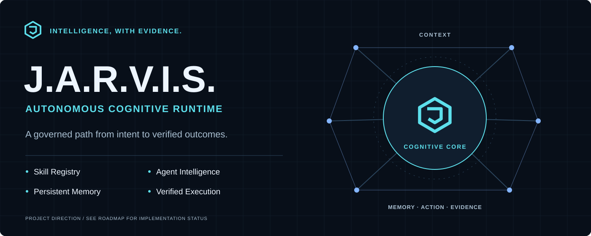
</p>

<p align="center">
  <strong>Runtime Cognitivo Local-First para Agentes de IA — Skills Governadas, Orçamento Determinístico de Contexto em Bytes UTF-8, Memória Episódica e Verificação Baseada em Evidências</strong>
</p>

<p align="center">
  <a href="https://github.com/robertoatila/jarvis-skill-registry/releases/tag/v0.1.0"></a>
  <a href="LICENSE"></a>
  
  
  
  
  
  
</p>

<p align="center">
  <a href="https://jarvis-skill-registry.vercel.app"><strong>Project Site</strong></a> ·
  <a href="QUICKSTART.md"><strong>Quickstart</strong></a> ·
  <a href="docs/README.md"><strong>Documentation (`docs/README.md`)</strong></a> ·
  <a href="evidence/current.json"><strong>Current Evidence (`evidence/current.json`)</strong></a> ·
  <a href="#-mapa-de-slides-roteiro-pronto-para-apresentação"><strong>Mapa de Slides</strong></a> ·
  <a href="#slide-06--funções-classes-e-gateway-mcp-8-ferramentas"><strong>MCP & Funções</strong></a> ·
  <a href="#slide-08--gráficos-benchmarks-de-contexto-e-bateria-de-testes"><strong>Gráficos & Benchmarks</strong></a> ·
  <a href="#slide-09--passo-a-passo-de-instalação-configuração-e-execução"><strong>Passo a Passo</strong></a>
</p>

---

## 🛡️ Fronteira de Governança e Evidência Executável

J.A.R.V.I.S. responde a uma pergunta central de engenharia de sistemas autônomos: **qual evidência verificável é obrigatória antes que a ação de um agente de IA seja considerada confiável?**

> **Program Governance Notice (Automated Contract):** The repository is active development. Its public [`v0.1.0 — Cognitive Runtime Foundation`](https://github.com/robertoatila/jarvis-skill-registry/releases/tag/v0.1.0) release is the immutable baseline, whereas the broader `v0.2.0` program remains `DIRECT_VALIDATION_REQUIRED` (`INCOMPLETE`) in [`evidence/current.json`](evidence/current.json) until fresh target-platform gates complete. This project does not use GitHub Actions as a validation gate; validation relies exclusively on direct local execution receipts indexed in [`docs/README.md`](docs/README.md). Context benchmarks measure `serialized_utf8_bytes` only — this documentation does not claim token savings or dollar cost reduction, and does not claim whole-system certification while `v0.2.0` gates remain open.

### Distinção Auditada: Snapshot Público (`main`) vs Estação Soberana Local

| Dimensão | Snapshot Público Rastreado (`main`) | Estação Soberana Local (`E:\.skill-registry`) | Fonte de Auditoria |
| :--- | :--- | :--- | :--- |
| **Arquivos & Topologia** | **1.888 arquivos rastreados** (`895` `.md`, `445` `.json`, `38` `.jsonl` com `64.192` registros) | **9.290 arquivos** (`306,7 MB`), **5.877 notas** em `JARVIS/` + **33 MOCs** (`00`–`32`) | `reports/reanalysis/2026-10-01-public-system-audit.md` |
| **Arsenal de Skills** | **524 arquivos `SKILL.md`** (canônicas + staged de adaptação) | **392 skills canônicas ativas** (`392/392` com frontmatter Go-schema válido) | `skills/` · `schemas/` |
| **Radar Tecnológico** | Índices curados e grafo Obsidian animado (`23.897` nós no showcase) | **27.900+ repositórios** indexados em matriz **SQLite FTS5** sub-milissegundo | `06 - GitHub Starred Repositories.md` · `tooling/` |
| **Memória Episódica** | `state/jarvis_memory.json` (template público vazio e higienizado) | `state/jarvis_memory.local.json` (memória privada ignorada pelo Git) | `tooling/agentic/runtime_core.py` |
| **Bateria Executável** | `110` suítes Python + `3` suítes Node `.cjs` + `audit_documentation_claims.py` | **`792` testes executados** (`786` aprovados, `0` falhas, `0` erros em `115,5s`) | `run_tests.py` · `evidence/current.json` |

---

## 🎤 Mapa de Slides (Roteiro Pronto para Apresentação)

Estrutura em **10 slides técnicos** pronta para apresentação de arquitetura, defesa técnica ou demonstração ao vivo:

| Slide | Tópico da Apresentação | Gráfico / Artefato Principal | Tempo Sugerido |
| :---: | :--- | :--- | :---: |
| **01** | Problema em Agentes de IA & Invariantes Matemáticas | Admissão de Bytes UTF-8 (`compile_context`) + Separação Tripla de Estados | `1 min` |
| **02** | Stack Zero-Dependency, Frameworks e Arquitetura de 5 Camadas | Python 3.12 Stdlib, ES Modules HUD, `LAYER 1`–`LAYER 5` e 6 IDEs Alvo | `1 min` |
| **03** | Ciclo Cognitivo de 9 Estágios (`JarvisAgenticRuntime`) | `flowchart LR` (`OBSERVE` → `ADAPT`) + Topologia Interna de Execução | `1.5 min` |
| **04** | Máquinas de Estado Ortogonais & Fluxo MCP Progressive Disclosure | `stateDiagram-v2` + `sequenceDiagram` JSON-RPC 2.0 Stdio | `1 min` |
| **05** | Os 5 Esquadrões Táticos, Vault Obsidian e Memória Hipocampo | Tabela dos 5 Esquadrões + Demonstrações Visuais Auditadas | `1 min` |
| **06** | Funções, Classes Críticas e Gateway MCP (`8` Ferramentas Reais) | `jarvis.py`, `tooling/jarvis_mcp_server.py`, `context_governor.py`, `runtime_core.py` | `1.5 min` |
| **07** | Segurança Soberana `SSP-v13.4`, Política `R0`–`R5` e Quarentena | 118 Tombstones, Auditoria de Claims e Barreira Fail-Closed | `1 min` |
| **08** | Gráficos de Benchmark de Contexto e Bateria de 792 Testes | `xychart-beta` (`4140 B` vs `2197 B` e Suítes de Teste) + `pie` | `1 min` |
| **09** | Passo a Passo de Instalação, Configuração MCP e Operação | Comandos nativos Windows/POSIX, JSON MCP e modos do `jarvis.py` | *(apoio técnico)* |
| **10** | Roteiro Cronometrado de Demonstração Ao Vivo (6 Etapas) | Doctor → HUD `:8899` → MCP → Benchmark → Claim Audit → Vault | `3 min (live)` |

---

## Slide 01 — Problema Real e Invariantes do Runtime Cognitivo

> [!IMPORTANT]
> **Ponto-chave para apresentação:** Frameworks convencionais de agentes injetam dezenas de prompts/ferramentas de uma só vez no contexto, relêem o mesmo arquivo repetidamente durante loops de depuração e tratam `exit_code == 0` ou uma resposta textual do LLM como sinônimo de tarefa validada. O J.A.R.V.I.S. resolve esses três vetores com **governança determinística antes e depois da inferência**.

### 1. Invariante de Admissão Estrita de Contexto (`compile_context`)
Dada uma coleção candidata de fontes $S$, um subconjunto obrigatório $S_{\text{req}} \subseteq S$ e um teto rígido $B_{\max}$ em bytes UTF-8 serializados:

$$\sum_{s \in S_{\text{admitted}}} \operatorname{bytes}_{\text{UTF-8}}(s) \le B_{\max} \qquad \text{com} \qquad S_{\text{req}} \subseteq S_{\text{admitted}}$$

Fontes excedentes são deterministicamente podadas ou compactadas via `ContextCompactor`, enquanto `NoRepeatReadCache` bloqueia releituras idênticas por hash SHA-256 na mesma missão.

### 2. Invariante de Ortogonalidade entre Execução e Verificação (`VerificationEngine`)
O runtime proíbe colapsar "rodou" em "passou". Três máquinas de estado independentes governam cada missão:

$$\texttt{ExecutionState} \;\perp\; \texttt{VerificationState} \;\implies\; \texttt{MissionOutcome}$$

Uma ação concluída sem evidência verificável recebe `UNVERIFIED_COMPLETION`, nunca `VERIFIED_SUCCESS`.

---

## Slide 02 — Stack Soberana, Frameworks e Arquitetura `LAYER 1`–`LAYER 5`

### 1. Matriz de Tecnologias e Runtimes Auditados

| Camada | Tecnologia / Motor | Versão / Escopo | Papel Arquitetural no Repositório |
| :--- | :--- | :---: | :--- |
| **Core & MCP Server** | Python Standard Library | `Python 3.10+` (`3.12` rec.) | `http.server`, `sqlite3` (FTS5), `hashlib` (SHA-256/Merkle), `hmac`, `subprocess`, `unittest` (**0 pacotes `pip` obrigatórios**) |
| **Cockpit Visual (HUD)**| HTML5 + Vanilla ES Modules + CSS Tokens | Nativo (`127.0.0.1:8899`) | `ui/index.html`, `ui/jarvis.js`, `ui/chat-session.js` e `ui/experience-system.js` com síntese neural TTS e Web Speech |
| **Design System** | Tokens CSS Canônicos (`--jv-*`) | Dark & Light Themes | `design-system/{tokens,components,patterns}.css` validado por paridade byte-a-byte com `ui/assets/design-system/` |
| **Testes JS / Browser** | Node.js CommonJS Harness | `3` suítes `.cjs` ativas | `tests/test_chat_session.cjs`, `tests/test_runtime_observability.cjs` e `tests/test_operational_cockpit.cjs` |
| **Governança Windows** | PowerShell Verification Harnesses | `PS 5.1 / 7+` | Contratos de empacotamento, isolamento, distribuição OCI e integridade das Fases `0`–`33` |
| **Grafo Cognitivo** | Markdown Canônico + Obsidian Graph | `33` MOCs / `5.870+` nós | Memória de longo prazo navegável por links bidirecionais e metadados auditáveis |

### 2. Hierarquia de 5 Camadas (`docs/ARCHITECTURE_5_LAYERS.md`) e 6 Adaptadores de IDE

- **`LAYER 1` — Core Integrity:** Schemas JSON/Go-frontmatter, hashes SHA-256, Merkle roots e barreira de quarentena (`gov-quarantine-link-v1`).
- **`LAYER 2` — Skill & Knowledge Arsenal:** `392` skills canônicas particionadas por domínio + Radar FTS5 + Vault Obsidian.
- **`LAYER 3` — Cognitive Runtime (`tooling/agentic/`):** `CognitiveGovernor`, `PolicyEngine`, `compile_context()`, `ExecutionDAG`, `VerificationEngine` e `MemoryFabric`.
- **`LAYER 4` — Target Platform Adapters (`adapters/<platform>/adapter.json`):** Projeção determinística multi-agente para **Google Antigravity**, **Cursor IDE**, **Claude Code**, **OpenAI Codex**, **GitHub Copilot** e **Windsurf / Cline**.
- **`LAYER 5` — Experience & Sovereign MCP Surface:** Cockpit tático Mark-LIV (`http://127.0.0.1:8899`), servidor JSON-RPC Stdio (`tooling/jarvis_mcp_server.py`) e trilha Remote Companion (`/remote/`).

---

## Slide 03 — Ciclo Cognitivo de 9 Estágios e Topologia de Execução

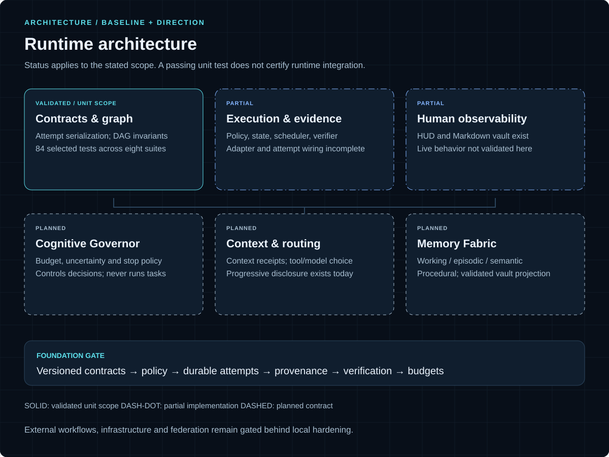

No código real (`tooling/agentic/runtime_core.py`), `JarvisAgenticRuntime.execute_mission()` orquestra um pipeline fechado de **9 estágios auditáveis**:

```mermaid
flowchart LR
    S1["1. OBSERVE<br/>Telemetria OS + Intenção"] --> S2["2. PLAN<br/>ExecutionDAG + Decomposição"]
    S2 --> S3["3. RESOLVE<br/>compile_context() <= B_max"]
    S3 --> S4["4. DELEGATE<br/>ModelRouter + ToolRouter"]
    S4 --> S5["5. EXECUTE<br/>WaveScheduler + Policy R0-R5"]
    S5 --> S6["6. VERIFY<br/>VerificationEngine + SHA-256"]
    S6 --> S7["7. MEASURE<br/>UTF-8 Bytes + Latência"]
    S7 --> S8["8. LEARN<br/>MemoryFabric Episódica"]
    S8 --> S9["9. ADAPT<br/>Ajuste de Rota / Fallback"]
```

### Fluxo Interno de Governança entre Submódulos

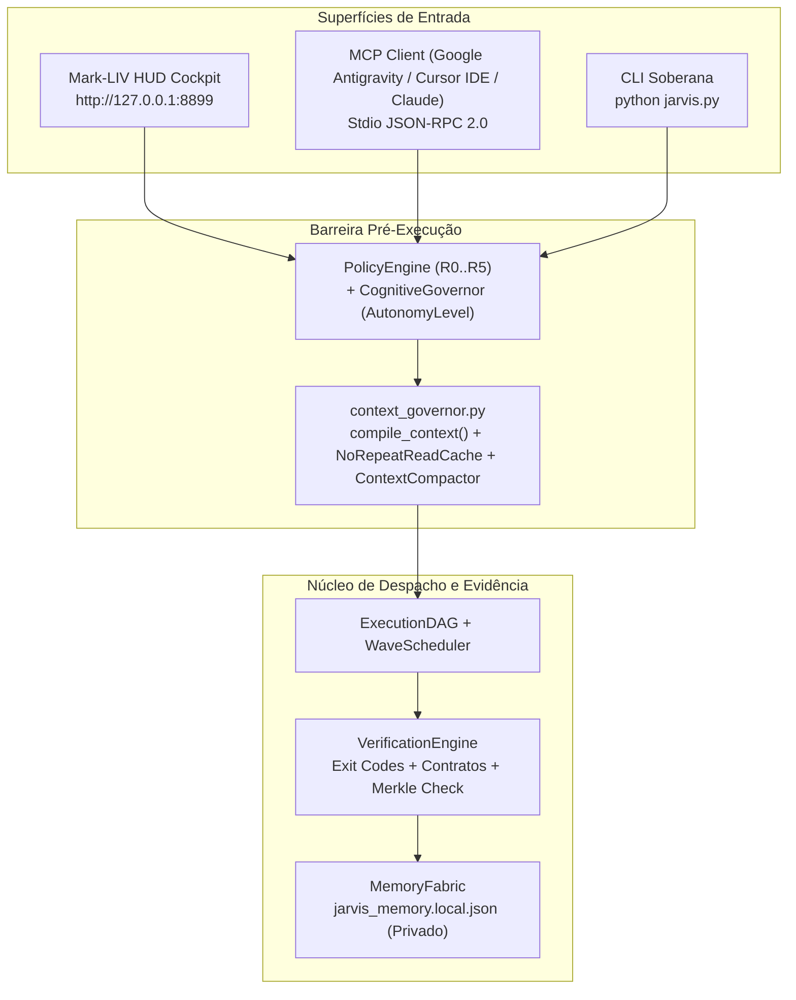

---

## Slide 04 — Máquinas de Estado e Progressive Disclosure via MCP

### 1. Separação Formal de Estados (`ExecutionState` × `VerificationState` × `MissionOutcome`)

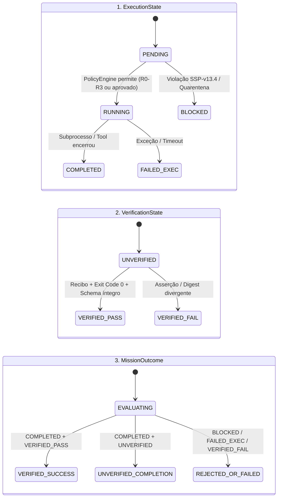

### 2. Sequência JSON-RPC 2.0 no `tooling/jarvis_mcp_server.py` (Progressive Disclosure)

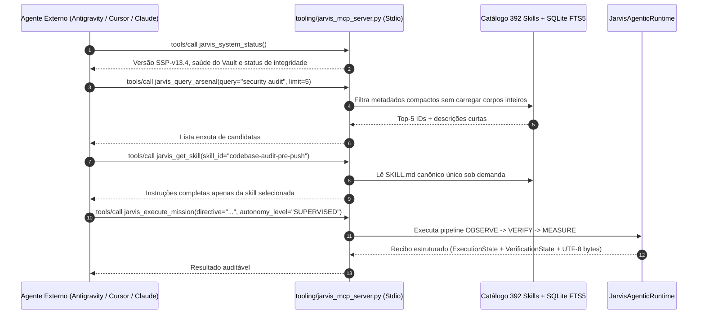

---

## Slide 05 — Os 5 Esquadrões Táticos e o Vault Cognitivo Obsidian

Todas as **392 skills canônicas** e os **27.900+ repositórios indexados** são classificados em cinco esquadrões operacionais:

| Esquadrão | Domínio Tático | Capacidades e Ferramentas Representativas |
| :--- | :--- | :--- |
| **🦅 01 Cyberspace** | Segurança Ofensiva & AppSec | Auditoria BOLA/IDOR, testes de SQLi/XSS, análise binária e engenharia reversa (`rea`, `api-security-testing`, `sql-injection-testing`). |
| **🛡️ 02 Aegis** | Defesa Ativa, Criptografia & Gateways | Verificação Merkle, barreira de quarentena, hardening OAuth2/JWT, DevSecOps e SAST/SBOM (`security-review`, `codebase-audit-pre-push`). |
| **🧠 03 Neuro-Cognitive** | Runtimes Agênticos, RAG & Memória | Orquestração por DAG, orçamento de contexto, roteamento multi-modelo e busca vetorial (`task-dag-orchestrator`, `qdrant`, `polars`). |
| **⚡ 04 Tactical** | Kernel, Redes & Automação Nativa | Diagnóstico Linux/Windows, scripts defensivos POSIX/PowerShell, observabilidade e containers (`docker-expert`, `linux-troubleshooting`). |
| **🪐 05 Hyperion** | Engenharia Full-Stack & Sistemas UI | Design systems, micro-interações, Spring Boot, FastAPI, React 19, Next.js e testes E2E (`frontend-ui-engineering`, `springboot-verification`). |

### Evidências Visuais Gravadas no Repositório

| Loop Tático Decisão → Verificação (`82s`) | Topologia do Obsidian Cognitive Vault (`33 MOCs`) |
| :---: | :---: |
| <a href="docs/launch/DEMO_90S_EVIDENCE.md">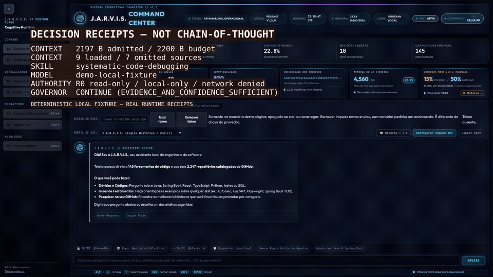</a><br><a href="docs/assets/jarvis-demo-90s.mp4"><strong>Assistir vídeo MP4 (82s)</strong></a> · <a href="docs/launch/DEMO_90S_EVIDENCE.md"><strong>Evidência da Demo</strong></a> | <a href="docs/assets/cognitive-vault-graph-animation.mp4">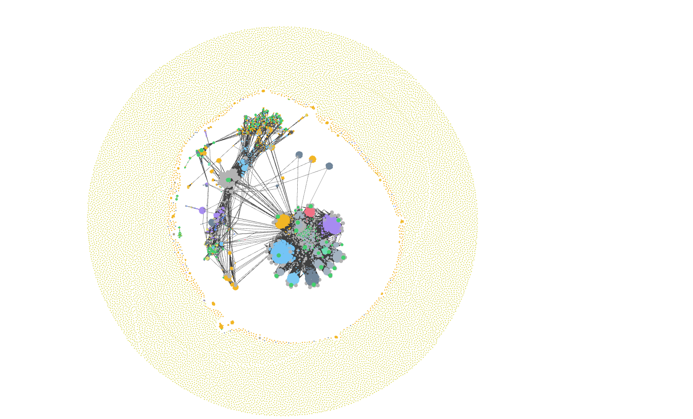</a><br><a href="docs/assets/cognitive-vault-graph-animation.mp4"><strong>Assistir exploração do grafo</strong></a> · <a href="docs/vault/COGNITIVE_ATLAS.md"><strong>Cognitive Atlas</strong></a> |

---

## Slide 06 — Funções, Classes e Gateway MCP (`8` Ferramentas)

### 1. Módulos e Assinaturas Principais em Python (`tooling/`)

| Arquivo / Módulo | Classes / Funções Críticas | Responsabilidade Técnica Exata |
| :--- | :--- | :--- |
| **`jarvis.py`** | `main()` · `--doctor` · `--test` · `--full-test` · `--port` · `--no-browser` | Launcher soberano zero-dependência: valida ambiente, executa auto-teste HTTP, roda a bateria mestre e inicia o cockpit em `127.0.0.1:8899`. *(Subcomandos `host`, `service`, `remote-doctor`, `remote-serve`, `remote-pair` e `remote-devices` compõem a trilha Windows/Mobile em validação na PR #79).* |
| **`tooling/agentic/context_governor.py`** | `compile_context(sources, budget_bytes)`<br>`NoRepeatReadCache`<br>`ContextCompactor` | Ordena fontes por prioridade/obrigatoriedade, garante teto determinístico em `serialized_utf8_bytes`, impede releituras duplicadas e emite recibo auditável de admissão/omissão. |
| **`tooling/agentic/runtime_core.py`** | `JarvisAgenticRuntime.execute_mission()`<br>`PolicyEngine` · `CognitiveGovernor`<br>`ExecutionDAG` · `WaveScheduler`<br>`VerificationEngine` · `MemoryFabric` | Aplica classificação de risco `R0`–`R5`, agenda ondas paralelas sem violar dependências do DAG, separa estado de execução de estado de verificação e persiste memória episódica local. |
| **`tooling/jarvis_server.py`** | Servidor HTTP local (`127.0.0.1:8899`) | Serve o Mark-LIV HUD, os assets verificados `/assets/design-system/*`, endpoints de telemetria, sessões de chat e observabilidade de missões. |
| **`tooling/audit_documentation_claims.py`** | `load_manifest()` · `audit_text()` · `validate_manifest_sources()` | Gate determinístico que falha se qualquer documento governado violar [`evidence/current.json`](evidence/current.json) (ex.: alegar economia financeira/tokens não autorizada ou omitir suítes Node existentes). |
| **`tooling/audit_pre_publish_security.py`** | Auditoria `SSP-v13.4` pré-publicação | Varre arquivos elegíveis à publicação contra padrões de chaves privadas, tokens de API e vazamento de dados locais do Vault. |

### 2. Catálogo Completo das **8 Ferramentas** do `jarvis-sovereign-gateway` (`tooling/jarvis_mcp_server.py`)

| Ferramenta MCP | Argumentos JSON | Comportamento Determinístico |
| :--- | :--- | :--- |
| `jarvis_system_status` | `{}` | Retorna saúde do runtime, protocolo `SSP-v13.4`, contagem do arsenal e estado do Vault. |
| `jarvis_query_arsenal` | `{"query": str, "limit"?: int}` | Pesquisa indexada nas `392` skills canônicas retornando apenas metadados enxutos. |
| `jarvis_get_skill` | `{"skill_id": str}` | Carrega sob demanda o corpo completo do `SKILL.md` requisitado (*Progressive Disclosure*). |
| `jarvis_radar_search` | `{"query": str, "limit"?: int}` | Consulta SQLite FTS5 de baixa latência sobre os `27.900+` repositórios curados. |
| `jarvis_verify_integrity` | `{}` | Verifica integridade estrutural, schemas e tombstones de quarentena do registro. |
| `jarvis_consult_protocol` | `{"protocol_name": str}` | Recupera diretrizes normativas de segurança, governança ou arquitetura soberana. |
| `jarvis_execute_mission` | `{"directive": str, "autonomy_level"?: str}` | Dispara missão governada pelo `JarvisAgenticRuntime` com recibo de verificação. |
| `jarvis_weaponize_tool` | `{"repo_name": str, "squadron": str, "description": str, "tags"?: list}` | Registra/estrutura um novo candidato técnico dentro da taxonomia dos 5 Esquadrões. |

### 3. Configuração Correta do Cliente MCP (`tooling/jarvis_mcp_server.py`)

Adicione ao arquivo de configuração do **Google Antigravity**, **Cursor IDE**, **Claude Desktop** ou **Claude Code**:

```json
{
  "mcpServers": {
    "jarvis-sovereign-gateway": {
      "command": "python",
      "args": ["E:\\.skill-registry\\tooling\\jarvis_mcp_server.py"],
      "env": {
        "PYTHONUTF8": "1",
        "JARVIS_FAIL_CLOSED": "true"
      }
    }
  }
}
```

---

## Slide 07 — Segurança Fail-Closed (`SSP-v13.4`) e Escala de Risco (`R0`–`R5`)

| Nível de Risco | Natureza da Operação | Política do `PolicyEngine` |
| :---: | :--- | :--- |
| **`R0`** | Leitura pura de telemetria, busca FTS5 e consulta de índice | Execução autônoma imediata |
| **`R1`** | Leitura localizada de arquivos do repositório e compilação de contexto | Execução permitida com registro em `NoRepeatReadCache` |
| **`R2`** | Execução de suítes de teste locais determinísticas e linters read-only | Permitida sob perfil supervisionado com captura obrigatória de exit code |
| **`R3`** | Escrita confinada ao workspace / atualização controlada de artefatos | Exige validação pós-execução pelo `VerificationEngine` |
| **`R4`** | Alterações de serviço residente, rede/transporte ou configuração sensível | Requer aprovação explícita vinculada ao digest exato da operação |
| **`R5`** | Ações destrutivas irrestritas, violação de quarentena (`118` tombstones) ou exfiltração | **Bloqueio Fail-Closed imediato** |

---

## Slide 08 — Gráficos, Benchmarks de Contexto e Bateria de Testes

### 1. Benchmark Real de Admissão de Contexto (`benchmarks/context_budget_benchmark.py`)

> Medição auditada em `serialized_utf8_bytes` (`repository-context-admission-v2`: `16` fontes candidatas, `9` admitidas, `7` omitidas, `3/3` obrigatórias preservadas, fração admitida `0,5307`). *Nota normativa: this benchmark measures serialized UTF-8 bytes and does not claim token savings or dollar cost reduction.*

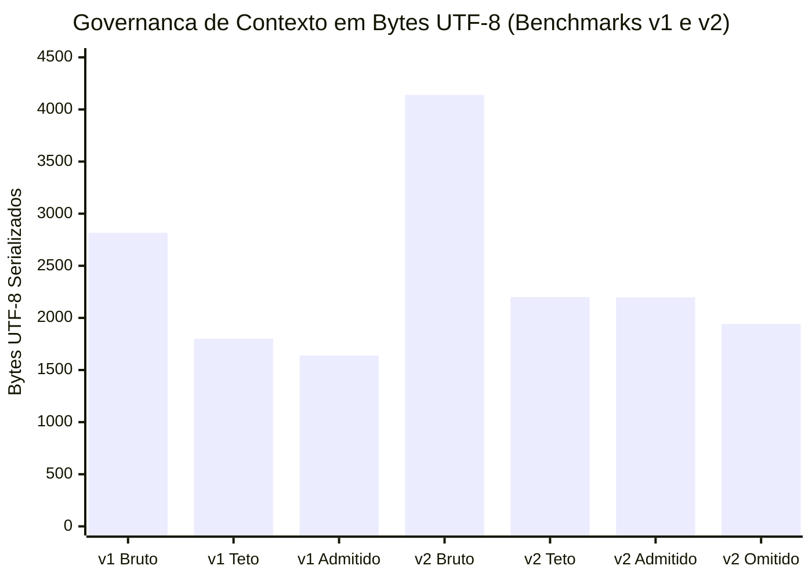

### 2. Bateria Executável Verificada (`python run_tests.py` & Contratos)

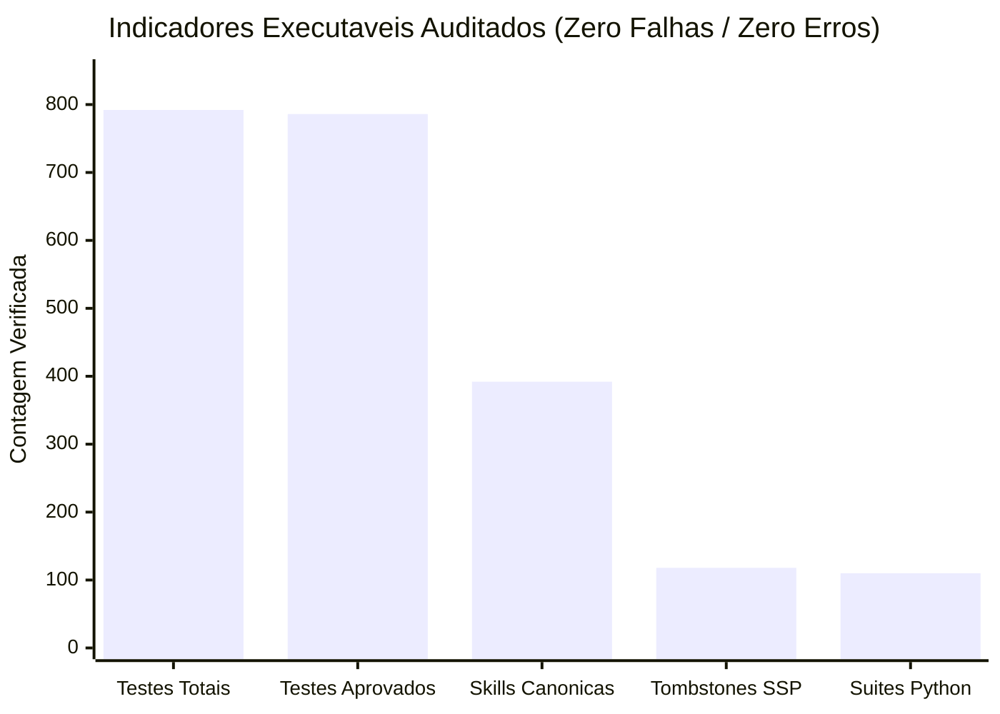

### 3. Composição Auditada do Snapshot Público Rastreado (`1.888` Arquivos)

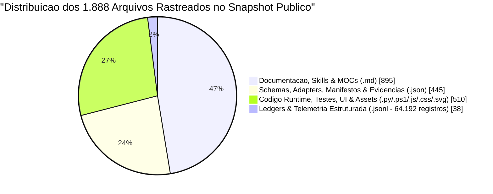

---

## Slide 09 — Passo a Passo de Instalação, Configuração e Execução

### Pré-requisitos
- **Python 3.10+** (**Python 3.12** recomendado) — nenhuma instalação `pip` é necessária para o núcleo.
- **Node.js 20+** *(opcional para rodar as `3` suítes `.cjs` de contrato de interface)*.
- **Git** e navegador moderno (Chromium, Edge ou Firefox).

### Passo 1 — Clonar e Diagnosticar o Ambiente

```bash
git clone https://github.com/robertoatila/jarvis-skill-registry.git
cd jarvis-skill-registry

# Verifica interpretador Python, estrutura de diretórios, templates e portas locais:
python jarvis.py --doctor
```

### Passo 2 — Executar Auto-Teste e Subir o Mark-LIV Cockpit

```bash
# Auto-teste rápido do servidor HTTP e rotas críticas:
python jarvis.py --test

# Inicia o runtime soberano em http://127.0.0.1:8899 e abre o navegador:
python jarvis.py

# Alternativa headless em porta customizada (para servidores/terminais dedicados):
python jarvis.py --port 9000 --no-browser
```

> O HUD inicia **100% offline** sem necessidade de chaves de API externas. Inferência assistida por provedores externos é estritamente opcional e documentada em [`QUICKSTART.md`](QUICKSTART.md) e [`docs/architecture/SERVER_INFERENCE_BOUNDARY.md`](docs/architecture/SERVER_INFERENCE_BOUNDARY.md).

### Passo 3 — Executar os Benchmarks e Gates Diretos de Validação

```bash
# 1. Executar a bateria mestre de 110 suítes Python (792 testes):
python run_tests.py

# 2. Reproduzir o benchmark determinístico de admissão de contexto (UTF-8 bytes):
python benchmarks/context_budget_benchmark.py

# 3. Executar as 3 suítes Node.js de observabilidade e sessão do cockpit:
node tests/test_chat_session.cjs
node tests/test_runtime_observability.cjs
node tests/test_operational_cockpit.cjs

# 4. Auditar honestidade documental contra evidence/current.json e higiene SSP-v13.4:
python tooling/audit_documentation_claims.py
python tooling/audit_pre_publish_security.py
```

---

## Slide 10 — Roteiro de Demonstração Ao Vivo (6 Etapas)

Sequência prática de **3 a 4 minutos** ideal para demonstração técnica ou slides ao vivo:

1. **Diagnóstico Zero-Cloud (`30s`):** Rodar `python jarvis.py --doctor` mostrando inicialização instantânea sobre Python stdlib sem dependência de nuvem ou chaves externas.
2. **Cockpit Tático Mark-LIV (`45s`):** Iniciar `python jarvis.py`, abrir `http://127.0.0.1:8899` e navegar pelas abas `Neural`, `Arsenal`, `Subagents`, `Security`, `Pipeline` e `Obsidian`, alternando entre tema escuro e claro (`design-system/tokens.css`).
3. **Orçamento Determinístico de Contexto (`45s`):** Executar `python benchmarks/context_budget_benchmark.py` ao vivo e destacar no JSON como `4.140` bytes candidatos são contidos em `2.197` bytes (`teto 2.200 B`) preservando `3/3` fontes obrigatórias.
4. **Progressive Disclosure via MCP (`45s`):** Demonstrar um agente em **Google Antigravity** ou **Cursor IDE** chamando `jarvis_query_arsenal` seguido de `jarvis_get_skill`, carregando apenas a skill exata sem poluir a janela de contexto.
5. **Auditoria Automática Anti-Alucinação Documental (`30s`):** Executar `python tooling/audit_documentation_claims.py` provando que o próprio `README.md` é fiscalizado contra [`evidence/current.json`](evidence/current.json).
6. **Exploração do Vault Cognitivo (`30s`):** Abrir `00 - J.A.R.V.I.S. Cognitive Vault.md` no Obsidian exibindo os `33` MOCs e a topologia de conhecimento conectada aos `5` Esquadrões Táticos.

---

## 📚 Índice Canônico da Documentação

| Documento | Escopo e Finalidade |
| :--- | :--- |
| [`QUICKSTART.md`](QUICKSTART.md) | Guia rápido de configuração, execução offline e solução de problemas |
| [`docs/README.md`](docs/README.md) | Arquitetura da informação separando documentos canônicos, ativos e históricos |
| [`evidence/current.json`](evidence/current.json) | Manifesto legível por máquina do status de validação (`v0.2.0` `DIRECT_VALIDATION_REQUIRED`) |
| [`docs/ARCHITECTURE_5_LAYERS.md`](docs/ARCHITECTURE_5_LAYERS.md) | Detalhamento completo da hierarquia `LAYER 1` a `LAYER 5` |
| [`docs/ADAPTER_DEVELOPMENT_GUIDE.md`](docs/ADAPTER_DEVELOPMENT_GUIDE.md) | Contrato de criação de adaptadores `adapters/<platform>/adapter.json` |
| [`docs/architecture/RUNTIME_EXECUTION_CONTRACT.md`](docs/architecture/RUNTIME_EXECUTION_CONTRACT.md) | Semântica formal de autoridade, execução, verificação e recuperação |
| [`docs/architecture/SERVER_INFERENCE_BOUNDARY.md`](docs/architecture/SERVER_INFERENCE_BOUNDARY.md) | Fronteira de segurança para provedores opcionais de inferência |
| [`docs/vault/COGNITIVE_ATLAS.md`](docs/vault/COGNITIVE_ATLAS.md) | Estrutura dos 33 MOCs, perfis de grafo e preservação do Vault Obsidian |
| [`docs/roadmap/JARVIS_AUTONOMOUS_INTELLIGENCE_PLAN.md`](docs/roadmap/JARVIS_AUTONOMOUS_INTELLIGENCE_PLAN.md) | Roadmap técnico evolutivo do runtime cognitivo |

---

## 🤝 Contribuição, Segurança e Licença

Contribuições focadas — novas skills canônicas, testes determinísticos, adaptadores de plataforma e melhorias verificáveis — são bem-vindas. Leia [`CONTRIBUTING.md`](CONTRIBUTING.md) e [`AGENTS.md`](AGENTS.md) antes de abrir um Pull Request.

Relatos de vulnerabilidade seguem [`SECURITY.md`](SECURITY.md) (incluindo a política `Fail-Closed Quarantine Barrier`). A convivência na comunidade segue o [`CODE_OF_CONDUCT.md`](CODE_OF_CONDUCT.md).

Distribuído sob a licença **[Apache License 2.0](LICENSE)**. Skills curadas e projetos referenciados no Radar preservam suas respectivas licenças originais.
